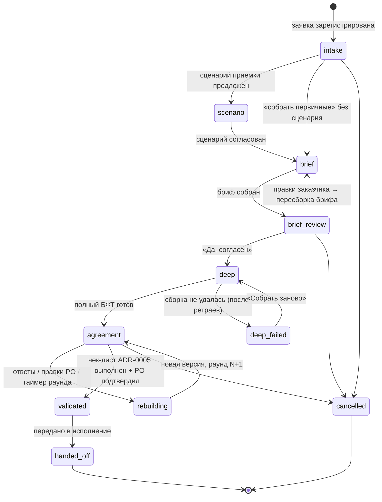
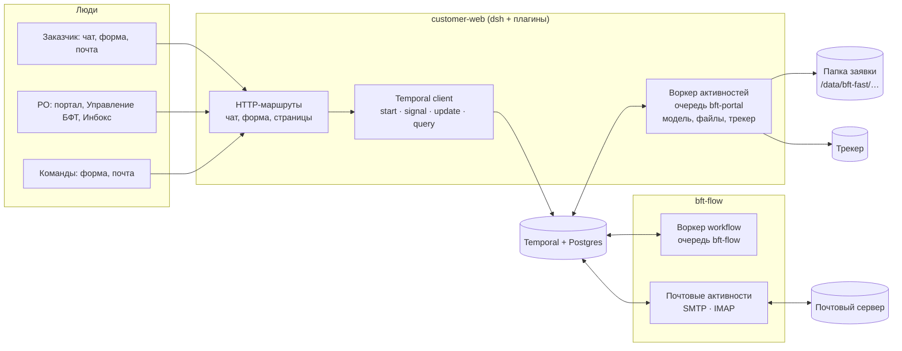
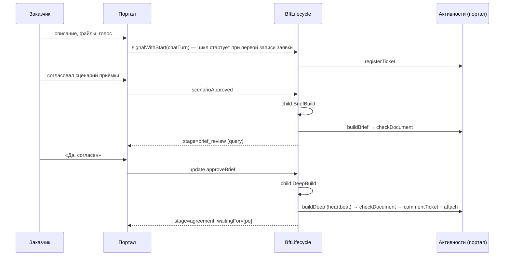
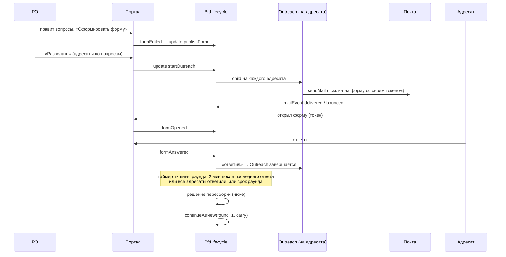
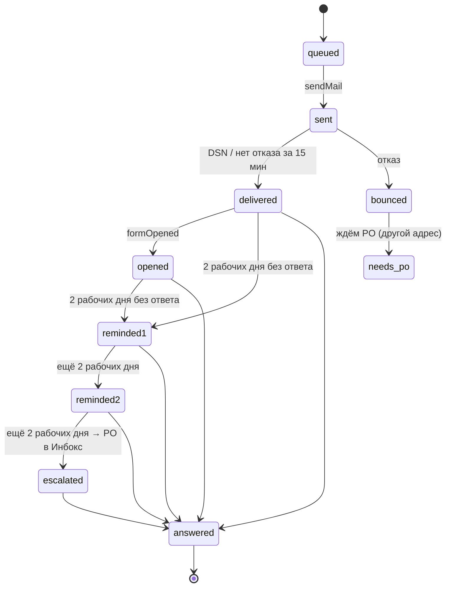

# Спека: жизненный цикл БФТ на Temporal

## Задача

Одна заявка на БФТ — один долгий процесс. В нём фиксируется **каждое**
взаимодействие: бриф, полная проработка, форма вопросов, ответы, рассылка и
статусы писем, ответы письмом, правки, пересборки. По любой заявке видно, на
какой она стадии, чего ждёт, от кого, сколько и что было до этого.

## Словарь

| Термин | Значение |
|---|---|
| **Заявка** | Обращение заказчика с задачей в трекере; ключ — `taskId` |
| **Цикл** | Workflow `BftLifecycle` заявки, `workflowId = bft-<taskId>` |
| **Стадия** | Доменное состояние цикла (ниже); единственный источник — цикл |
| **Раунд** | Полный БФТ → форма → рассылка → ответы → пересборка; номер растёт |
| **Событие** | Signal/update в цикл; у каждого `eventId` (дедупликация) и `actor` |
| **Артефакт** | Файл заявки (бриф, полный БФТ, форма, письмо); в истории — `ArtifactRef` |
| **Адресат** | Кому задан вопрос: заказчик или команда; у адресата — свой `Outreach` |

## Стадии



`stage` — для людей и проекций (трекер, Инбокс). Внутри стадии цикл держит
**ожидания** `waitingFor[]`: `customer`, `po`, `team:<имя>`, `model` — то, что
сейчас мешает двигаться дальше (как `waiting_for` в Коробке, ADR-0005).

Соответствие колонкам трекера (проекция, пишет только цикл):

| Стадия цикла | Колонка «Запросы» |
|---|---|
| intake, scenario, brief, brief_review | Создан |
| deep, deep_failed | Проработка БФТ |
| agreement, rebuilding — ждём PO | Ожидает PO |
| agreement — ждём адресатов | Проработка БФТ |
| validated | Оценка |
| handed_off | В работу: … (выбор PO) |
| cancelled | Отменено |

## Топология



- **Только портал** говорит с людьми и стартует/сигналит циклы.
- **`bft-flow`** — код workflow (детерминированный) и почтовые активности.
- **Портал как воркер активностей** — всё, что требует модели dsh (`ctx.llm`),
  файлов заявки и трекера: сборка брифа и полного БФТ, правки, форма,
  выгрузки, комментарии в трекер.
- Входящая почта: расписание Temporal `MailboxPoll` (раз в минуту) читает
  ящик и маршрутизирует письма в циклы по токену (ниже).

## Workflow

### `BftLifecycle(input)` — родительский, один на заявку

```ts
interface LifecycleInput {
  taskId: number; slug: string; sessionId: string
  customer: { name: string; email?: string }
  createdAt: string
  carry?: CarryState          // при continueAsNew — состояние прошлого раунда
}

interface LifecycleState {
  stage: Stage; waitingFor: Wait[]; round: number
  artifacts: { brief?: ArtifactRef; deep?: ArtifactRef; form?: FormRef }
  questions: { total: number; answered: number; unknown: number }
  outreach: Record<string, OutreachSummary>   // адресат → статус
  timeline: TimelineEntry[]                    // последние 200 событий для экрана
  seenEvents: string[]                         // eventId за раунд — дедупликация
}
```

Цикл — «сущность»: в бесконечном цикле ждёт событие или таймер, применяет
его к состоянию (чистая функция `reduce(state, event)` — тестируется без
Temporal), запускает работу (дочерний workflow или активность) и обновляет
проекции (`syncTracker`, search attributes).

### Дочерние

| Workflow | Что делает | Таймауты и ретраи |
|---|---|---|
| `BriefBuild` | разведка источников → бриф (fast) → проверки | модель: 3 попытки, backoff ×3; всего ≤ 20 мин |
| `DeepBuild` | полный БФТ по согласованному брифу + ответы раунда | 3 попытки; heartbeat каждые 30 с; ≤ 40 мин |
| `Revision` | точечные правки ADR-0021 (найти → заменить, проверки, откат) | 2 попытки; ≤ 10 мин |
| `Outreach` | один адресат раунда: письмо → ждём → напомнить → эскалировать | живёт до ответа, отмены или конца раунда |
| `FormRound` | версия формы раунда, ключ, публикация, сбор ответов | закрывается с раундом |

Отдельно от цикла (не дочерний): `ConfluencePublish` — отправка БФТ в Confluence
(ADR-0028, сценарий 8), `bft-<taskId>-confluence-<n>`, query `progress`; цикл получает
только записи хроники.

Политика `parentClosePolicy`: `REQUEST_CANCEL` для `Outreach` (конец раунда
отменяет напоминания), `TERMINATE` для сборок при отмене заявки.

## События

Каждое событие: `{ eventId, at, actor: { kind: customer|po|team|system|mail, id? }, ... }`.
`eventId` ставит источник (портал, почтовый поллер); повтор игнорируется.

### Signals (запись, ответа не ждут)

| Signal | Кто шлёт | Что делает цикл |
|---|---|---|
| `chatTurn {summary, materials[]}` | портал после хода ассистента | хроника; новые материалы → `artifacts`; в стадии brief_review — пометка «есть правки» |
| `scenarioProposed {ref}` / `scenarioApproved` | инструмент чата | stage → scenario / brief |
| `briefRequested` | ассистент («собрать первичные») | запускает `BriefBuild` |
| `formEdited {op}` | PO на странице БФТ | версия формы; если опубликована — перерасчёт адресатов |
| `formAnswered {answers[], author}` | портал (открытая форма, уже проверено) | `questions`; `Outreach` адресатов — «ответил»; таймер тишины раунда |
| `mailEvent {messageId, kind: sent\|delivered\|bounced\|deferred}` | почтовые активности / поллер | статус адресата; bounce → ждём PO |
| `mailReply {from, text, ref}` | поллер | активность разбора ответа → ответы формы → как `formAnswered` |
| `formOpened {addressee}` | портал (ссылка с токеном адресата) | статус адресата «открыл» |
| `reviseRequested {notes[], author}` | колонка «ИИ-агент» (ADR-0021) | запускает `Revision` |
| `trackerMoved {to, by}` | «Управление БФТ» | ручной перенос → стадия по таблице или пометка расхождения |
| `cancel {reason}` | PO | отмена дочерних, stage → cancelled |

### Updates (ответ нужен сразу, с проверкой)

| Update | Возвращает | Отказ |
|---|---|---|
| `approveBrief {by}` | `{approvedAt}` | бриф не собран / уже согласован |
| `publishForm` | `{formUrl}` | нет полного БФТ |
| `revokeForm` | `{formUrl}` (новый ключ) | — |
| `startOutreach {addressees[], template}` | `{scheduled}` | нет опубликованной формы, нет адресов |
| `rebuildNow {by}` | `{started}` | уже идёт сборка — в очередь |
| `validate {by}` | `{ok, gaps[]}` | чек-лист ADR-0005 не выполнен — список пробелов |
| `retryDeep` | `{started}` | не в deep_failed |

### Queries

- `status` → `{stage, waitingFor, round, questions, outreach, artifacts, updatedAt}`
  — то, что показывают Инбокс, «Управление БФТ», список БФТ (ADR-0020).
- `timeline {since?}` → хроника для вкладки «Жизненный цикл».

## Активности

| Активность | Очередь | Идемпотентность |
|---|---|---|
| `registerTicket`, `commentTicket`, `moveTicket`, `attachToTicket` | bft-portal | ключ `eventId`; перенос — «уже там» не ошибка |
| `buildBrief`, `buildDeep`, `reviseDeep` | bft-portal | результат пишется в новый файл ревизии, ссылка — по sha256 |
| `checkDocument` (bft-lint, canon-check) | bft-portal | чистая |
| `deriveForm`, `publishForm`, `revokeForm` | bft-portal | версия формы — по хэшу списка вопросов |
| `exportDocument` (docx/pdf/md) | bft-portal | по sha256 документа |
| `parseMailReply` (модель: текст письма → ответы по qid) | bft-portal | по `messageId` |
| `sendMail` | bft-flow | `Message-ID` = `<bft-<taskId>.r<round>.<addressee>.<n>@…>`; повтор не шлёт второй раз |
| `pollMailbox` | bft-flow | курсор UID IMAP в состоянии расписания |
| `mirrorWorkspace` | bft-portal | перезапись тех же файлов |
| `confluenceRender` (markdown → storage, схемы PNG, .docx/.pdf) | bft-confluence | чистая: тот же документ → то же тело (sha256) |
| `confluenceUpsertPage`, `confluenceAttach`, `confluenceFinish`, `confluenceAncestors` | bft-confluence (исполнитель публикации, сеть хоста, ключ записи) | `pageId` в `confluence-publish.json`; своя страница по метке `bft-<slug>`; вложение с тем же sha256 не грузится |

## Сценарии

### 1. Заявка → бриф → полный БФТ



### 2. Раунд согласования: форма, рассылка, ответы, пересборка



### 3. Напоминания и эскалация (`Outreach`)



Сроки — настройка цикла (рабочие дни по календарю организации); каждое
напоминание — отдельный `sendMail` с тем же токеном.

### 4. Ответ письмом

1. Адресат отвечает на письмо. `Reply-To` — общий ящик с меткой:
   `bft+<токен>@…` (или токен в `In-Reply-To`/`References` по `Message-ID`).
2. `MailboxPoll` находит цикл по токену → `signal mailReply` (текст без
   цитаты, вложения — в папку заявки).
3. Цикл → активность `parseMailReply`: модель сопоставляет текст с вопросами
   адресата (qid), неуверенные — «ответ письмом, требует разбора PO».
4. Разобранное — как `formAnswered`, источник «почта»; письмо — артефакт.

### 5. Решение о пересборке

На закрытии раунда (тишина 2 мин после ответа / все ответили / срок раунда /
`rebuildNow`) цикл выбирает, **что** делать:

| Условие | Действие |
|---|---|
| Ответов ≤ 5 и все — уточнения к существующим пунктам | `Revision`: точечные правки (ADR-0021), минуты |
| Ответ меняет границы, состав требований, роли | `DeepBuild` полностью, ответы — в контексте |
| Только «не знаю» | без пересборки; вопрос → PO |
| Идёт сборка | отложить до её конца (без потери событий) |

Классификацию делает активность (модель + правила), решение и причина — в
хронике. После сборки: новая версия формы (ADR-0018), `Outreach` получивших
ответ закрыты, для оставшихся вопросов — следующий раунд.

### 6. Правки и комментарии PO

- Колонка «ИИ-агент» → `reviseRequested` → `Revision`; итог по каждому
  замечанию — в хронику.
- Ручная правка файла вне портала — не событие; при следующей сборке
  проверка sha256 найдёт расхождение и запишет его в хронику.

### 7. Отмена, валидация, передача

- `cancel` — отменяет дочерние, закрывает форму (ключ отзывается),
  `moveTicket(Отменено)`.
- `validate` — проверка чек-листа ADR-0005: нет `[УТОЧНИТЬ]`, у договорённостей
  есть подтверждение, у требований — исполнитель. Пробелы — списком.
- `handed_off` — цикл завершается; история остаётся в Temporal (retention
  — по настройке namespace, архив — по решению владельца).

### 8. Отправка в Confluence (ADR-0028)

Актор — PO (или заказчик) на странице готового полного БФТ.

1. «⇪ В Confluence» в рейке → панель справа. Портал подбирает ТОП-5 родительских страниц
   без модели: куда уже публиковали, родитель похожего БФТ, страницы материалов и
   разведки заявки, поиск по названию и системам (read-only шлюз, ADR-0019). Каждая — с
   причиной. Своя страница — поиск по названию, вставка ссылки или номера.
2. «Отправить» → портал стартует `ConfluencePublish` (`bft-<taskId>-confluence-<n>`, n — номер
   прогона из `confluence-publish.json`), в хронику цикла — `note` «отправка начата».
   Идёт отправка — вторую не запускает, показывает текущую.
3. Workflow: `confluenceRender` (детерминированно) → `confluenceUpsertPage` (создать
   подстраницей родителя или обновить свою, метки `bft`, `bft-<slug>`) →
   `confluenceAttach` (схемы, .docx, .pdf; неизменённые не грузятся) → `confluenceFinish`
   (переименованные Confluence вложения — в тело; `confluence.json`) → `confluenceAnnounce`
   портала (комментарий в задачу, `note` «опубликовано» в цикл). Первые четыре исполняет
   `confluence-publisher` (очередь `bft-confluence`, ключ записи только у него).
4. Портал раз в 2 с читает `progress`: четыре шага, отметки, ссылка на страницу.
   Перезагрузка страницы — панель открывается сама, ход тот же (он в Temporal).
5. Ошибка: сеть, 5xx, 409, 429 — повторы внутри активности (5 раз), пользователь видит
   «идёт»; 401/403/нет родителя/чужая страница — `ConfluenceRejected`, без повторов,
   workflow `Failed`, текст причины — в панели, кнопки «Повторить» и «Выбрать другую».
6. Повторная отправка той же заявки — та же страница, новая версия; другой родитель —
   перенос страницы.

## Наблюдаемость

- **Search attributes** (SQL-видимость Temporal на postgres): `BftStage`,
  `BftTaskId`, `BftRound`, `BftWaitingFor` (keyword list), `BftCustomer`,
  `BftUpdatedAt`. Списки «всё, что ждёт PO», «зависшие > 3 дней» — запросом
  видимости, без своей БД.
- **Вкладка «Жизненный цикл»** в карточке заявки портала (и в карточке «БФТ»
  Инбокса): хроника `timeline`, текущие ожидания, адресаты со статусом писем.
- **Temporal UI** — администраторам за Authentik (полная история событий,
  повтор активностей, сброс workflow).
- Метрики воркеров (Prometheus) — в наблюдаемость сервера: длина очередей,
  длительность сборок, ошибки модели.

## Надёжность и безопасность

- **Детерминизм**: в workflow нет времени, случайности, I/O — только
  `workflow.now()`, таймеры, активности. `reduce()` — чистая функция с
  юнит-тестами; тест повтора сохранённых историй — в CI.
- **Версионирование**: изменения — на границе раунда (`continueAsNew`);
  внутри — `patched()`. Воркеры с build-id (Worker Versioning).
- **Рестарт портала** (выкладка): активности с heartbeat повторяются,
  таймеры и ожидания не теряются.
- **Публичные входы** (форма, почта) не трогают Temporal напрямую: портал
  проверяет ключ, лимиты (ADR-0018), токен письма — и только потом шлёт
  событие.
- **Персональные данные**: в истории — имена и адреса адресатов, тексты
  ответов — только ссылкой на артефакт. Кодек данных Temporal с шифрованием
  payload — до включения почты.
- **Лимиты памяти**: `temporal` ≤ 512 МБ, `bft-flow` ≤ 256 МБ.

## Переход (без остановки приёма заявок)

| Шаг | Что меняется | Готово, когда |
|---|---|---|
| 0. Инфраструктура | `temporal` (своя БД в postgres трекера), `bft-flow`, клиент и воркер в портале; UI за Authentik | цикл стартует на тестовой заявке, виден в UI |
| 1. Теневой режим | портал шлёт события во всех текущих точках (чат, согласования, форма, правки); цикл только пишет хронику и считает стадию; 12 старых заявок — догрузка событий из файлов | вкладка «Жизненный цикл» совпадает с реальностью на всех заявках |
| 2. Таймеры | пересборка по ответам формы — таймером цикла; `rebuildTimers` и скан при рестарте удалены | рестарт портала посреди паузы не теряет пересборку |
| 3. Сборки | бриф, полный БФТ, правки — дочерними workflow; маршруты портала шлют события вместо запуска напрямую | «Собрать заново» и ретраи — из цикла; стадия в Инбоксе — из `status` |
| 4. Трекер — проекция | колонку двигает только цикл; ручной перенос — `trackerMoved` | нет расхождений колонки и стадии |
| 5. Почта | `Outreach`, `MailboxPoll`, ответы письмом, напоминания, эскалация в Инбокс | живой прогон: письмо → ответ письмом → пересборка |
| 6. Решение о пересборке | правки vs полная сборка по классификации | раунд с 1–3 ответами закрывается правкой, не полной сборкой |
| 7. Валидация и передача | `validate`, `handed_off` | заявка доходит до «Согласован» без ручных шагов |

## Вопросы владельцу

1. **Почта**: отправка от общего ящика сервиса или от имени PO? Есть ли у
   организации SMTP/IMAP для сервиса или только шлюз (DavMail/Exchange)?
2. **Сроки**: 2 / 4 / 6 рабочих дней до напоминаний и эскалации — подходят?
   Календарь праздников — откуда?
3. **Кто рассылает**: адресаты и текст письма подтверждает PO перед
   отправкой (рекомендую) или цикл шлёт сам после публикации формы?
4. **Хранение истории**: сколько держать закрытые циклы (retention) и нужен
   ли архив в файлы/объектное хранилище?
5. **Валидация**: подтверждение «Согласован» — только PO или и заказчик
   (кнопка в форме)?
