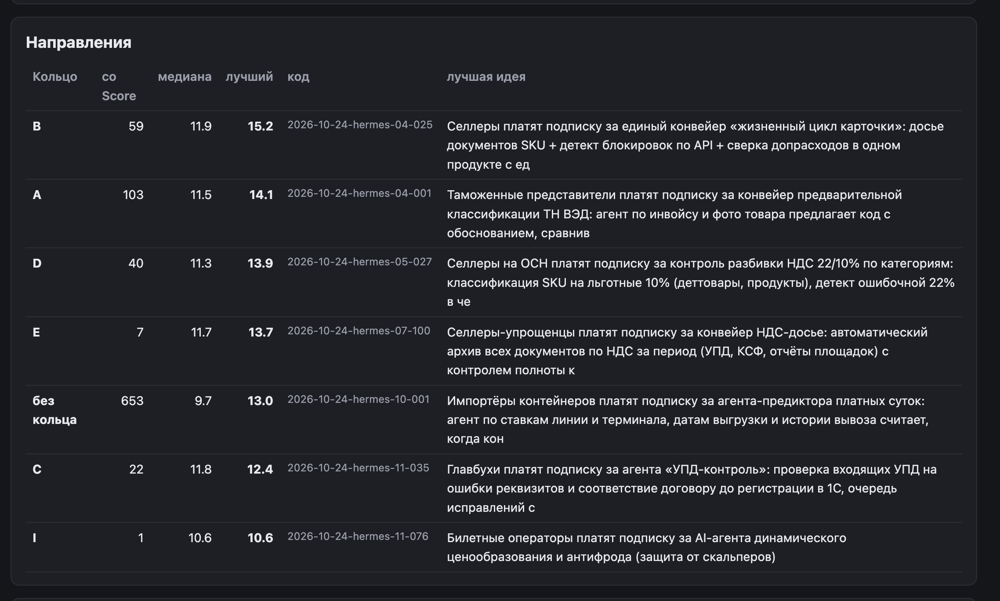

# Как оставить заявку на разбор инициативы

Напишите ваш запрос PO в любом виде: сообщением, письмом, голосовым или
приложите материалы встречи. Хватит трёх вещей — **что** нужно, **зачем**
и **когда** хотите результат.

PO перенесёт заявку в систему (как на скриншоте выше), и через минуту она
станет карточкой на доске инициатив.

Дальше от вас одно: отвечать на уточняющие вопросы в чат-комнате, куда
придёт приглашение. Всё остальное — статусы, напоминания, сроки — система
берёт на себя.

Когда требования согласованы, вы получите итоговый документ с границами
работ и зафиксированными договорённостями.
