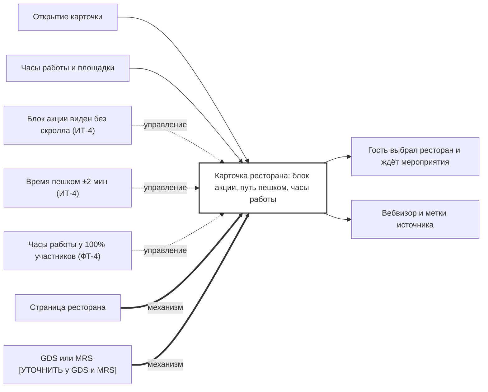

## Description

<!-- SECTION:DESCRIPTION:BEGIN -->
Карточка ресторана показывает блок акции, время пешком от площадки последнего билета и часы работы.

### Параметры
- **Вход:** Открытие карточки (BP-8.1); Часы работы и площадки (BP-2.1)
- **Управление:** Блок акции виден без скролла (ИТ-4); Время пешком ±2 мин (ИТ-4); Часы работы у 100% участников (ФТ-4)
- **Выход:** Гость выбрал ресторан и ждёт мероприятия (BP-12.1); Вебвизор и метки источника (BP-19.1)
- **Механизм:** Страница ресторана; GDS или MRS [УТОЧНИТЬ у GDS и MRS]

### IDEF0

### HowToDemo
1. Открываю карточку ресторана из списка
2. Без скролла вижу блок акции «−10% по билету»
3. Вижу время пешком от площадки последнего билета и часы работы
4. В вебвизоре видна сессия с меткой источника
<!-- SECTION:DESCRIPTION:END -->
