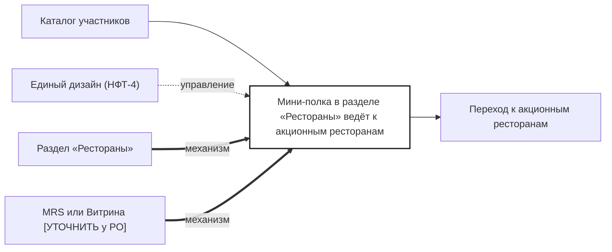

## Description

<!-- SECTION:DESCRIPTION:BEGIN -->
В разделе «Рестораны» появляется мини-полка спецпроекта — вход в акцию и посадочная для лидов.

### Параметры
- **Вход:** Каталог участников (BP-2.1)
- **Управление:** Единый дизайн (НФТ-4)
- **Выход:** Переход к акционным ресторанам (BP-8.1)
- **Механизм:** Раздел «Рестораны»; MRS или Витрина [УТОЧНИТЬ у PO]

### IDEF0

### HowToDemo
1. Открываю раздел «Рестораны» — вижу мини-полку спецпроекта
2. Нажимаю на полку — открывается список акционных ресторанов
3. Посадочная для лидов открывается по прямой ссылке
<!-- SECTION:DESCRIPTION:END -->
