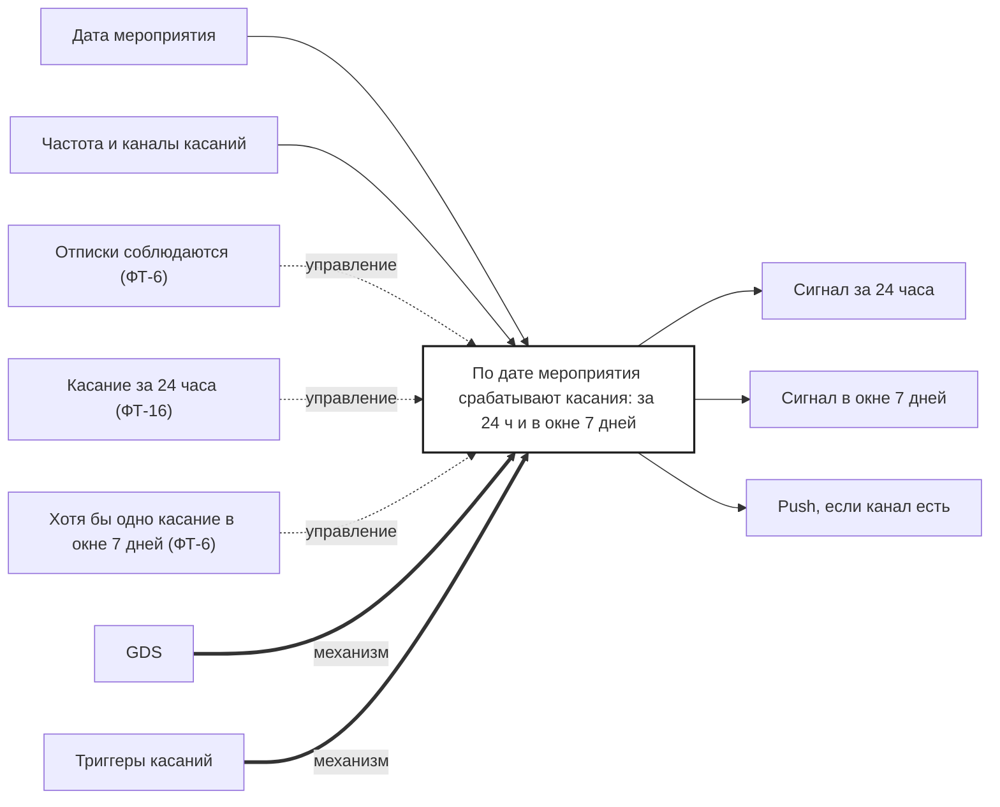

## Description

<!-- SECTION:DESCRIPTION:BEGIN -->
GDS по дате мероприятия запускает касания: оповещение за 24 часа и напоминание в окне 7 дней — с частотой и каналами от маркетинга.

### Параметры
- **Вход:** Дата мероприятия; Частота и каналы касаний (BP-3.1)
- **Управление:** Отписки соблюдаются (ФТ-6); Касание за 24 часа (ФТ-16); Хотя бы одно касание в окне 7 дней (ФТ-6)
- **Выход:** Сигнал за 24 часа (BP-12.1); Сигнал в окне 7 дней (BP-13.1); Push, если канал есть (BP-14.1)
- **Механизм:** GDS; Триггеры касаний

### IDEF0

### HowToDemo
1. Билет на мероприятие через сутки — срабатывает сигнал оповещения
2. Мероприятие прошло — в окне 7 дней срабатывает сигнал напоминания
3. Гость отписан — сигналы не уходят
<!-- SECTION:DESCRIPTION:END -->
