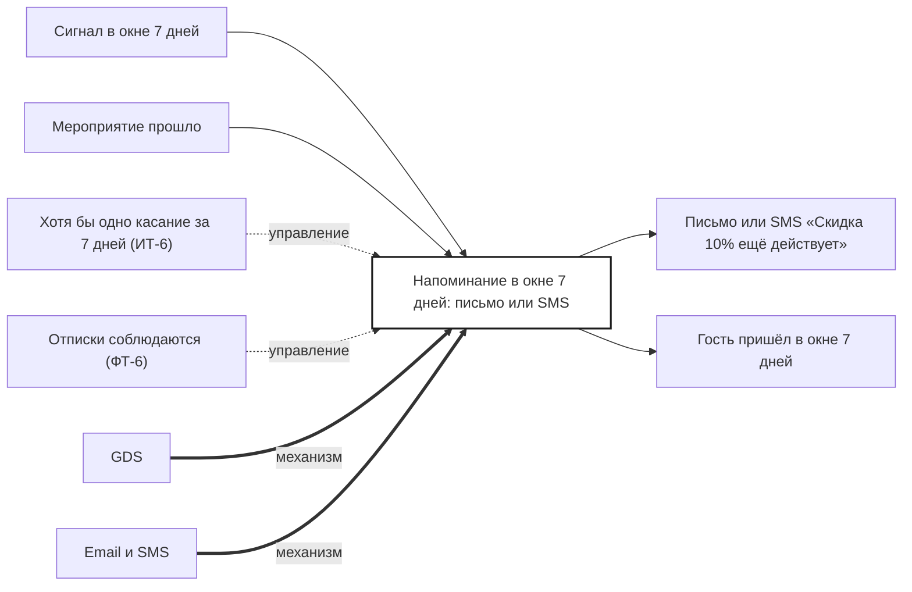

## Description

<!-- SECTION:DESCRIPTION:BEGIN -->
В окне 7 дней после мероприятия гость получает хотя бы одно напоминание письмом или SMS; отписки соблюдаются.

### Параметры
- **Вход:** Сигнал в окне 7 дней (BP-12.2); Мероприятие прошло (BP-12.1)
- **Управление:** Хотя бы одно касание за 7 дней (ИТ-6); Отписки соблюдаются (ФТ-6)
- **Выход:** Письмо или SMS «Скидка 10% ещё действует»; Гость пришёл в окне 7 дней (BP-15.1)
- **Механизм:** GDS; Email и SMS

### IDEF0

### HowToDemo
1. Мероприятие прошло — в течение 7 дней приходит письмо или SMS «Скидка 10% ещё действует»
2. Отписываюсь — следующие напоминания не приходят
<!-- SECTION:DESCRIPTION:END -->
