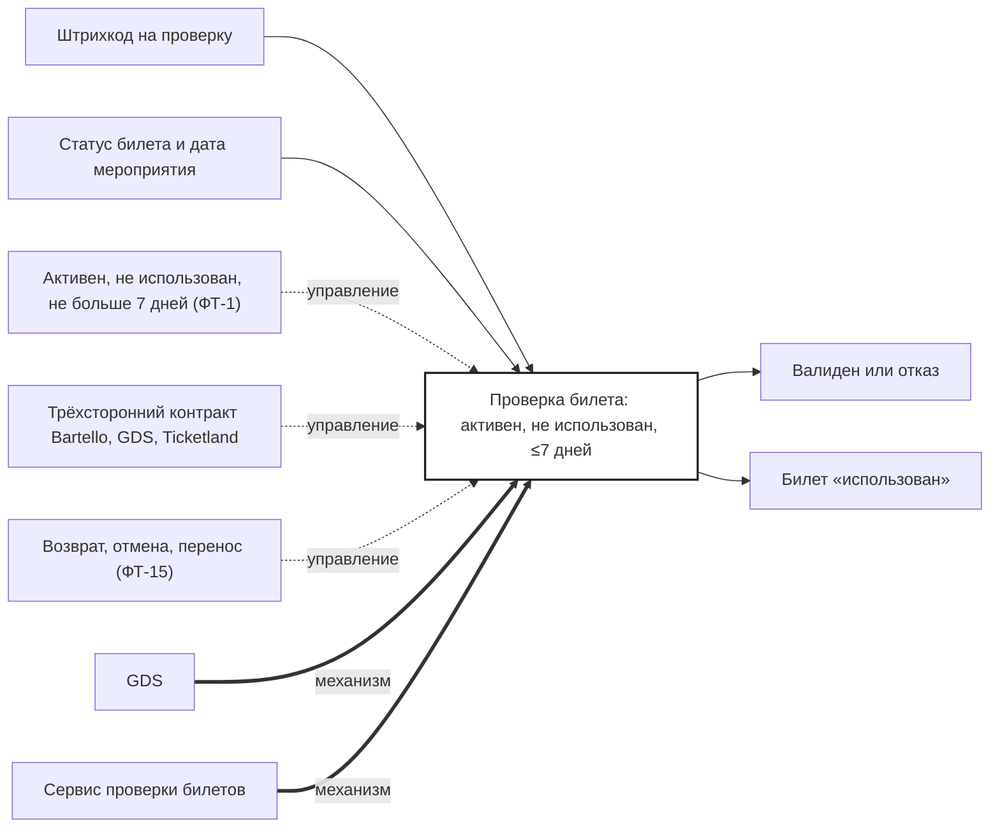

## Description

<!-- SECTION:DESCRIPTION:BEGIN -->
GDS проверяет штрихкод: билет активен, не использован, мероприятие было не больше 7 дней назад. Успех помечает билет «использован», отказ возвращается с понятной причиной.

### Параметры
- **Вход:** Штрихкод на проверку (BP-15.1); Статус билета и дата мероприятия
- **Управление:** Активен, не использован, не больше 7 дней (ФТ-1); Трёхсторонний контракт Bartello, GDS, Ticketland; Возврат, отмена, перенос (ФТ-15)
- **Выход:** Валиден или отказ (BP-15.1); Билет «использован» (BP-18.1)
- **Механизм:** GDS; Сервис проверки билетов

### IDEF0

### HowToDemo
1. Сканирую действующий билет — «валиден», билет помечен «использован»
2. Сканирую тот же билет снова — отказ «использован»
3. Сканирую билет вне окна 7 дней — отказ с причиной
<!-- SECTION:DESCRIPTION:END -->
