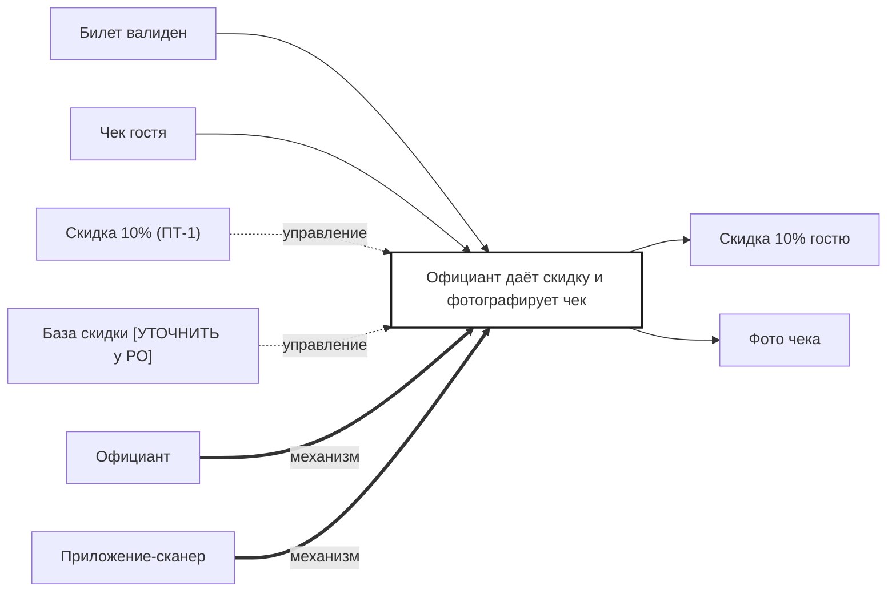

## Description

<!-- SECTION:DESCRIPTION:BEGIN -->
После проверки официант даёт скидку 10% и фотографирует чек после оплаты; Bartello фиксирует компенсацию ресторану.

### Параметры
- **Вход:** Билет валиден (BP-15.1); Чек гостя
- **Управление:** Скидка 10% (ПТ-1); База скидки [УТОЧНИТЬ у PO]
- **Выход:** Скидка 10% гостю; Фото чека (BP-18.1)
- **Механизм:** Официант; Приложение-сканер

### IDEF0

### HowToDemo
1. После проверки официант даёт скидку 10%
2. Гость оплачивает — официант фотографирует чек в приложении
3. Bartello фиксирует компенсацию ресторану
<!-- SECTION:DESCRIPTION:END -->
