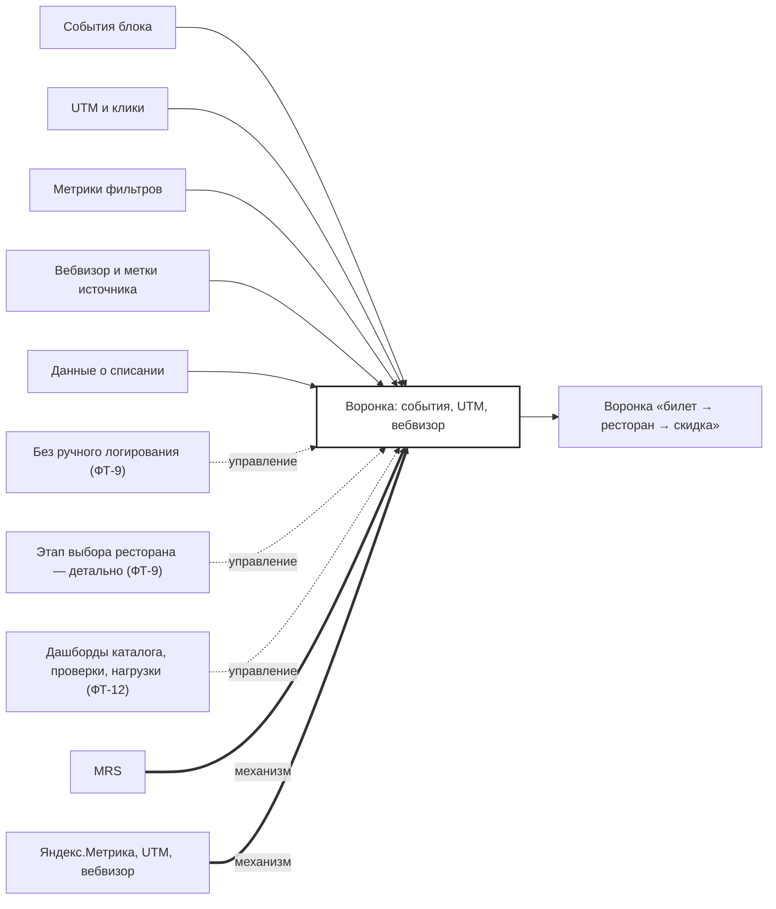

## Description

<!-- SECTION:DESCRIPTION:BEGIN -->
Витрина, письма и Bartello отдают события в аналитику; воронка «билет → ресторан → скидка» собирается без ручного логирования.

### Параметры
- **Вход:** События блока (BP-5.1); UTM и клики (BP-7.1); Метрики фильтров (BP-8.1); Вебвизор и метки источника (BP-10.1); Данные о списании (BP-18.1)
- **Управление:** Без ручного логирования (ФТ-9); Этап выбора ресторана — детально (ФТ-9); Дашборды каталога, проверки, нагрузки (ФТ-12)
- **Выход:** Воронка «билет → ресторан → скидка»
- **Механизм:** MRS; Яндекс.Метрика, UTM, вебвизор

### IDEF0

### HowToDemo
1. Прохожу путь от покупки до скидки
2. В воронке видны все этапы «билет → ресторан → скидка» без ручного логирования
3. Этап выбора ресторана разложен по фильтрам и карточкам
<!-- SECTION:DESCRIPTION:END -->
