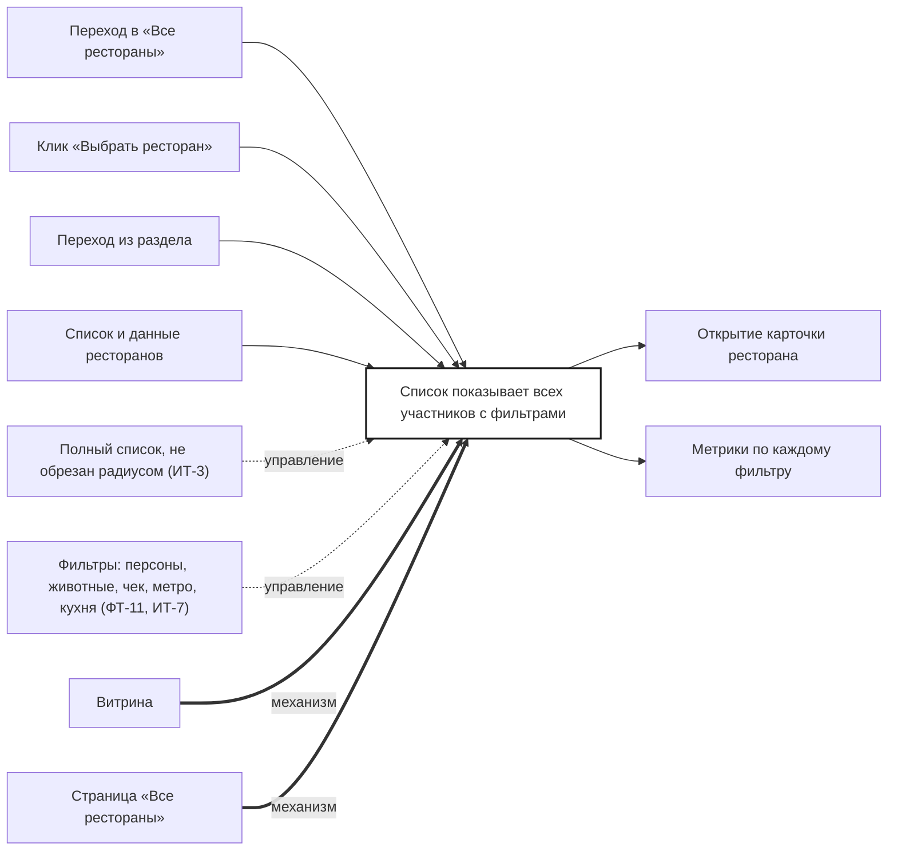

## Description

<!-- SECTION:DESCRIPTION:BEGIN -->
«Все рестораны» показывает всех участников без обрезки радиусом: ближние и с высоким рейтингом выше, фильтры по персонам, животным, чеку, метро и кухне.

### Параметры
- **Вход:** Переход в «Все рестораны» (BP-5.1); Клик «Выбрать ресторан» (BP-7.1); Переход из раздела (BP-11.1); Список и данные ресторанов (BP-9.1)
- **Управление:** Полный список, не обрезан радиусом (ИТ-3); Фильтры: персоны, животные, чек, метро, кухня (ФТ-11, ИТ-7)
- **Выход:** Открытие карточки ресторана (BP-10.1); Метрики по каждому фильтру (BP-19.1)
- **Механизм:** Витрина; Страница «Все рестораны»

### IDEF0

### HowToDemo
1. Открываю «Все рестораны» — вижу всех участников, ближние и с высоким рейтингом выше
2. Включаю фильтр «метро» — список сужается
3. Открываю ресторан — карточка с блоком акции
4. В аналитике видны метрики по фильтрам
<!-- SECTION:DESCRIPTION:END -->
