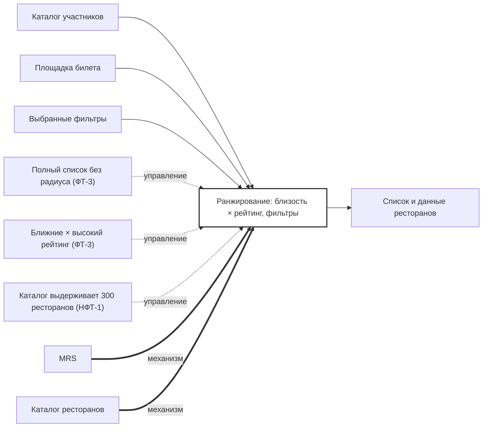

## Description

<!-- SECTION:DESCRIPTION:BEGIN -->
Для списка MRS ставит первыми рестораны у площадки билета, дальше — по близости и рейтингу, с учётом фильтров гостя.

### Параметры
- **Вход:** Каталог участников (BP-2.1); Площадка билета; Выбранные фильтры
- **Управление:** Полный список без радиуса (ФТ-3); Ближние × высокий рейтинг (ФТ-3); Каталог выдерживает 300 ресторанов (НФТ-1)
- **Выход:** Список и данные ресторанов (BP-8.1)
- **Механизм:** MRS; Каталог ресторанов

### IDEF0

### HowToDemo
1. Открываю «Все рестораны» — рестораны у площадки билета первыми
2. Дальше — по близости и рейтингу, без обрезки радиусом
3. Фильтры гостя сужают выдачу
<!-- SECTION:DESCRIPTION:END -->
