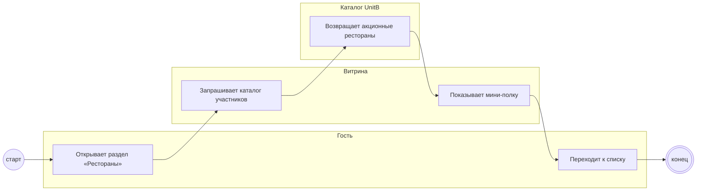

## Description

<!-- SECTION:DESCRIPTION:BEGIN -->
В разделе «Рестораны» появляется мини-полка спецпроекта — вход в акцию и посадочная для лидов.

### UserStory
Как гость раздела «Рестораны», я хочу заметить акционные рестораны, чтобы воспользоваться скидкой по билету.

### JobStory
- Когда я листаю раздел «Рестораны», хочу увидеть полку спецпроекта, чтобы узнать об акции.

### Параметры
- **Вход:** Каталог участников (BP-2.1)
- **Управление:** Единый дизайн (НФТ-4)
- **Выход:** Переход к акционным ресторанам (BP-8.1)
- **Механизм:** Раздел «Рестораны»; UnitB или Витрина [УТОЧНИТЬ у PO]

### Процесс
- Гость: Открывает раздел «Рестораны»
- Витрина: Запрашивает каталог участников
- Каталог UnitB: Возвращает акционные рестораны
- Витрина: Показывает мини-полку
- Гость: Переходит к списку

### BPMN

### HowToDemo
1. Открываю раздел «Рестораны» — вижу мини-полку спецпроекта
2. Нажимаю на полку — открывается список акционных ресторанов
3. Посадочная для лидов открывается по прямой ссылке
<!-- SECTION:DESCRIPTION:END -->
