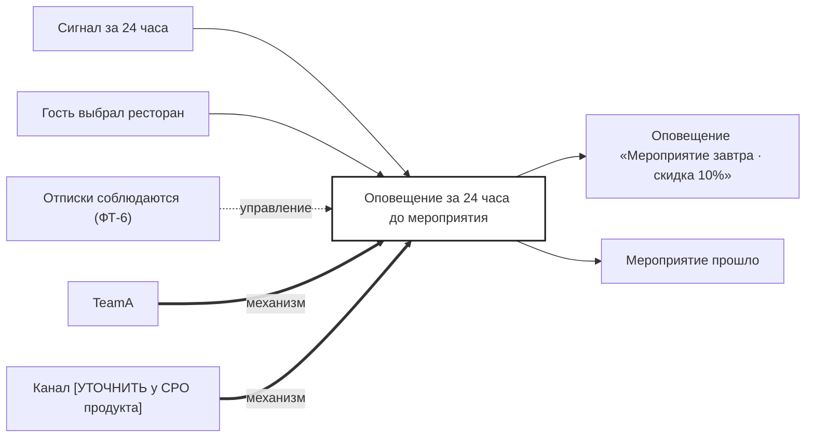

## Description

<!-- SECTION:DESCRIPTION:BEGIN -->
За 24 часа до мероприятия гость получает оповещение «Мероприятие завтра · скидка 10%». Канал — [УТОЧНИТЬ у CPO продукта].

### Параметры
- **Вход:** Сигнал за 24 часа (BP-12.2); Гость выбрал ресторан (BP-10.1)
- **Управление:** Отписки соблюдаются (ФТ-6)
- **Выход:** Оповещение «Мероприятие завтра · скидка 10%»; Мероприятие прошло (BP-13.1)
- **Механизм:** TeamA; Канал [УТОЧНИТЬ у CPO продукта]

### IDEF0

### HowToDemo
1. Покупаю билет на мероприятие завтра
2. За 24 часа приходит оповещение «Мероприятие завтра · скидка 10%»
3. Гость, отписанный от касаний, оповещение не получает
<!-- SECTION:DESCRIPTION:END -->
