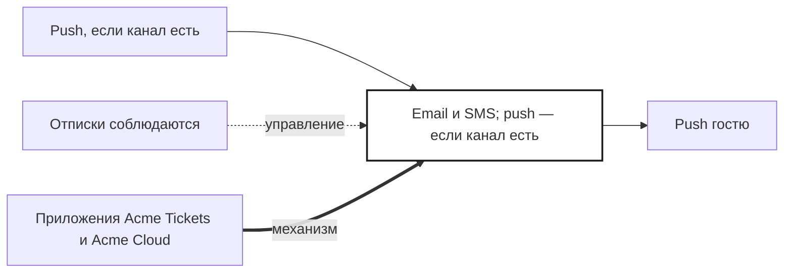

## Description

<!-- SECTION:DESCRIPTION:BEGIN -->
Если приложения поддерживают push, напоминание о скидке приходит и туда — [УТОЧНИТЬ] есть ли канал.

### Параметры
- **Вход:** Push, если канал есть (BP-12.2)
- **Управление:** Отписки соблюдаются
- **Выход:** Push гостю
- **Механизм:** Приложения Acme Tickets и Acme Cloud

### IDEF0

### HowToDemo
1. Наступает окно напоминания — приходит push о скидке, если приложение его поддерживает
2. Без push-канала напоминание уходит письмом или SMS
<!-- SECTION:DESCRIPTION:END -->
