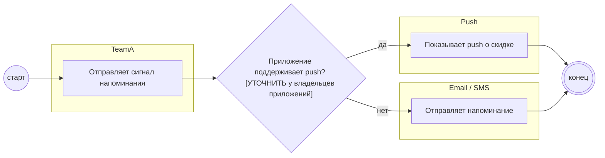

## Description

<!-- SECTION:DESCRIPTION:BEGIN -->
Если приложения поддерживают push, напоминание о скидке приходит и туда — [УТОЧНИТЬ] есть ли канал.

### UserStory
Как гость с приложением, я хочу получить push о скидке, чтобы не пропустить напоминание в почте.

### JobStory
- Когда я не читаю почту, хочу увидеть напоминание в приложении, чтобы не потерять скидку.

### Параметры
- **Вход:** Push, если канал есть (BP-12.2)
- **Управление:** Отписки соблюдаются
- **Выход:** Push гостю
- **Механизм:** Приложения Acme Tickets и Acme Cloud

### Процесс
- TeamA: Отправляет сигнал напоминания
- ? Приложение поддерживает push? [УТОЧНИТЬ у владельцев приложений]
  - да → Push: Показывает push о скидке
  - нет → Email / SMS: Отправляет напоминание

### BPMN

### HowToDemo
1. Наступает окно напоминания — приходит push о скидке, если приложение его поддерживает
2. Без push-канала напоминание уходит письмом или SMS
<!-- SECTION:DESCRIPTION:END -->
