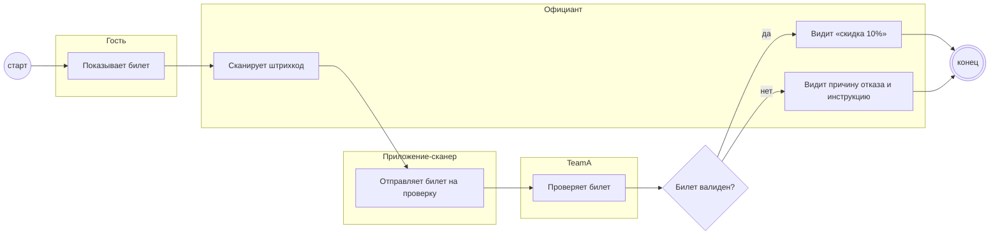

## Description

<!-- SECTION:DESCRIPTION:BEGIN -->
Гость показывает билет, официант сканирует штрихкод в приложении-сканере. TeamA проверяет билет: валиден — скидка 10% и билет «использован», иначе — отказ с понятной причиной.

### UserStory
Как официант, я хочу отсканировать билет гостя и сразу увидеть ответ, чтобы дать скидку без споров.

### JobStory
- Когда гость показывает билет, хочу за секунды понять, давать ли скидку, чтобы не задерживать стол.
- Когда приходит отказ, хочу видеть понятную причину, чтобы объяснить её гостю.
- Когда штрихкод не читается, хочу знать, что делать, чтобы не потерять гостя [УТОЧНИТЬ у DineClub].

### Параметры
- **Вход:** Билет гостя со штрихкодом; Гость пришёл в окне 7 дней (BP-13.1); Ресторан подключён (BP-1.1); Валиден или отказ (BP-16.1); Экраны сканера (BP-4.1)
- **Управление:** Инструкция и FAQ для официанта (ФТ-13); Приложение не обязательно нативное
- **Выход:** Штрихкод на проверку (BP-16.1); Билет валиден — скидка (BP-17.1); Отказ с причиной на экране
- **Механизм:** Официант; Приложение-сканер — владелец [УТОЧНИТЬ у DineClub]

### Процесс
- Гость: Показывает билет
- Официант: Сканирует штрихкод
- Приложение-сканер: Отправляет билет на проверку
- TeamA: Проверяет билет
- ? Билет валиден?
  - да → Официант: Видит «скидка 10%»
  - нет → Официант: Видит причину отказа и инструкцию

### BPMN

### HowToDemo
1. Гость показывает билет, официант сканирует штрихкод
2. Действующий билет — на экране «скидка 10%»
3. Билет уже использован — отказ с понятной причиной
4. Инструкция и FAQ открываются из приложения
<!-- SECTION:DESCRIPTION:END -->
