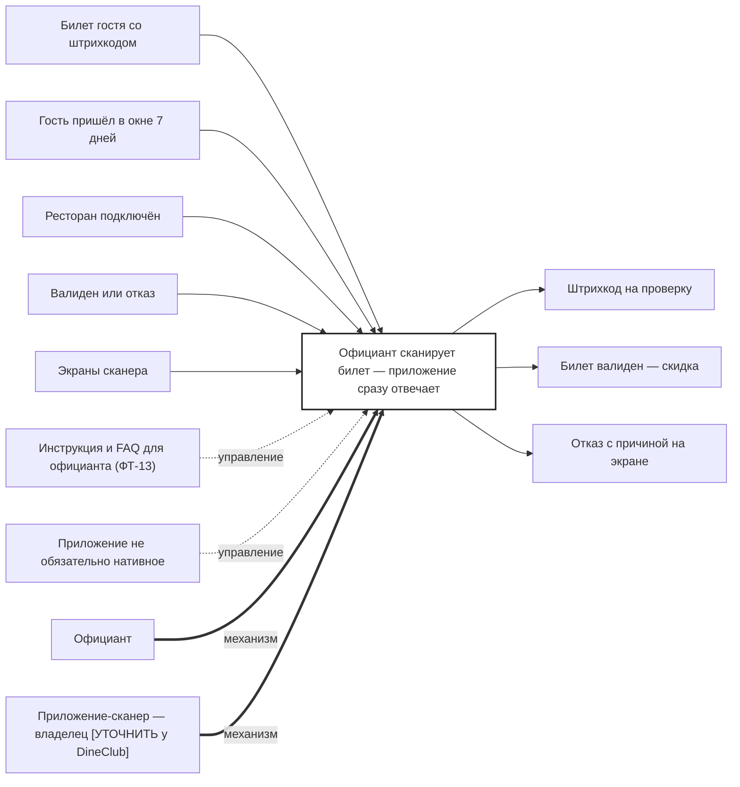

## Description

<!-- SECTION:DESCRIPTION:BEGIN -->
Гость показывает билет, официант сканирует штрихкод в приложении-сканере. TeamA проверяет билет: валиден — скидка 10% и билет «использован», иначе — отказ с понятной причиной.

### Параметры
- **Вход:** Билет гостя со штрихкодом; Гость пришёл в окне 7 дней (BP-13.1); Ресторан подключён (BP-1.1); Валиден или отказ (BP-16.1); Экраны сканера (BP-4.1)
- **Управление:** Инструкция и FAQ для официанта (ФТ-13); Приложение не обязательно нативное
- **Выход:** Штрихкод на проверку (BP-16.1); Билет валиден — скидка (BP-17.1); Отказ с причиной на экране
- **Механизм:** Официант; Приложение-сканер — владелец [УТОЧНИТЬ у DineClub]

### IDEF0

### HowToDemo
1. Гость показывает билет, официант сканирует штрихкод
2. Действующий билет — на экране «скидка 10%»
3. Билет уже использован — отказ с понятной причиной
4. Инструкция и FAQ открываются из приложения
<!-- SECTION:DESCRIPTION:END -->
