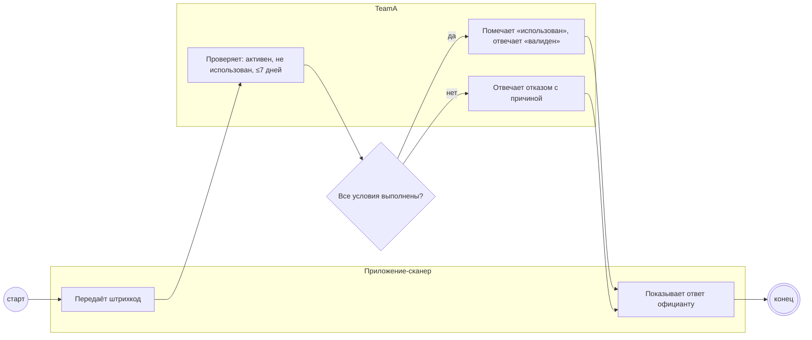

## Description

<!-- SECTION:DESCRIPTION:BEGIN -->
TeamA проверяет штрихкод: билет активен, не использован, мероприятие было не больше 7 дней назад. Успех помечает билет «использован», отказ возвращается с понятной причиной.

### UserStory
Как команда TeamA, я хочу проверять билет по штрихкоду, чтобы одна покупка давала ровно одну скидку.

### JobStory
- Когда приходит штрихкод, хочу проверить активность, использование и окно 7 дней, чтобы не выдать лишнюю скидку.
- Когда проверка прошла, хочу пометить билет «использован», чтобы повтор получил отказ.

### Параметры
- **Вход:** Штрихкод на проверку (BP-15.1); Статус билета и дата мероприятия
- **Управление:** Активен, не использован, не больше 7 дней (ФТ-1); Трёхсторонний контракт DineClub, TeamA, Acme Tickets; Возврат, отмена, перенос (ФТ-15)
- **Выход:** Валиден или отказ (BP-15.1); Билет «использован» (BP-18.1)
- **Механизм:** TeamA; Сервис проверки билетов

### Процесс
- Приложение-сканер: Передаёт штрихкод
- TeamA: Проверяет: активен, не использован, ≤7 дней
- ? Все условия выполнены?
  - да → TeamA: Помечает «использован», отвечает «валиден»
  - нет → TeamA: Отвечает отказом с причиной
- Приложение-сканер: Показывает ответ официанту

### BPMN

### HowToDemo
1. Сканирую действующий билет — «валиден», билет помечен «использован»
2. Сканирую тот же билет снова — отказ «использован»
3. Сканирую билет вне окна 7 дней — отказ с причиной
<!-- SECTION:DESCRIPTION:END -->
