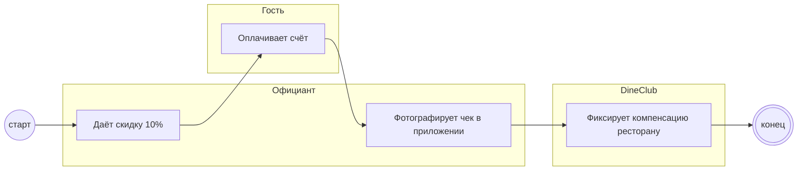

## Description

<!-- SECTION:DESCRIPTION:BEGIN -->
После проверки официант даёт скидку 10% и фотографирует чек после оплаты; DineClub фиксирует компенсацию ресторану.

### UserStory
Как официант, я хочу дать скидку и сфотографировать чек в приложении, чтобы ресторан получил компенсацию.

### JobStory
- Когда билет валиден, хочу применить скидку 10%, чтобы гость получил обещанное.
- Когда гость оплатил, хочу сфотографировать чек в одно касание, чтобы не задерживать смену.

### Параметры
- **Вход:** Билет валиден (BP-15.1); Чек гостя
- **Управление:** Скидка 10% (ПТ-1); База скидки [УТОЧНИТЬ у PO]
- **Выход:** Скидка 10% гостю; Фото чека (BP-18.1)
- **Механизм:** Официант; Приложение-сканер

### Процесс
- Официант: Даёт скидку 10%
- Гость: Оплачивает счёт
- Официант: Фотографирует чек в приложении
- DineClub: Фиксирует компенсацию ресторану

### BPMN

### HowToDemo
1. После проверки официант даёт скидку 10%
2. Гость оплачивает — официант фотографирует чек в приложении
3. DineClub фиксирует компенсацию ресторану
<!-- SECTION:DESCRIPTION:END -->
