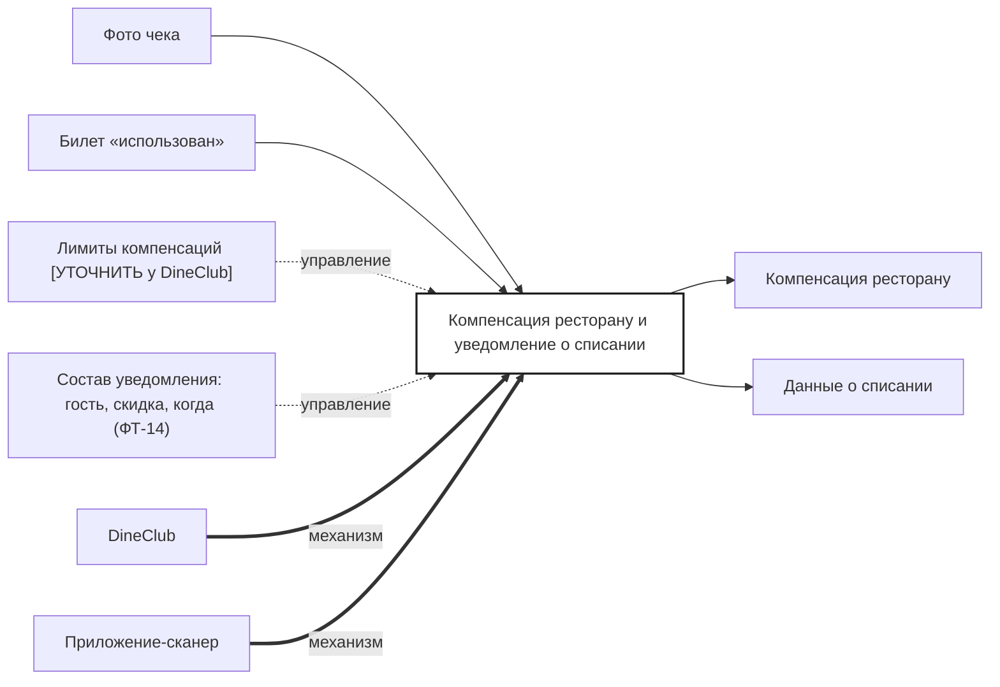

## Description

<!-- SECTION:DESCRIPTION:BEGIN -->
Фото чека попадает в DineClub: ресторану фиксируется компенсация, Acme Tickets получает уведомление о списании — гость, скидка, когда.

### Параметры
- **Вход:** Фото чека (BP-17.1); Билет «использован» (BP-16.1)
- **Управление:** Лимиты компенсаций [УТОЧНИТЬ у DineClub]; Состав уведомления: гость, скидка, когда (ФТ-14)
- **Выход:** Компенсация ресторану; Данные о списании (BP-19.1)
- **Механизм:** DineClub; Приложение-сканер

### IDEF0

### HowToDemo
1. Официант фотографирует чек — DineClub фиксирует компенсацию ресторану
2. Acme Tickets получает уведомление: гость, скидка, когда
<!-- SECTION:DESCRIPTION:END -->
