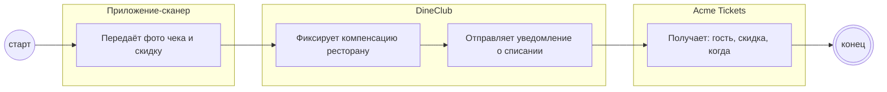

## Description

<!-- SECTION:DESCRIPTION:BEGIN -->
Фото чека попадает в DineClub: ресторану фиксируется компенсация, Acme Tickets получает уведомление о списании — гость, скидка, когда.

### UserStory
Как ресторан-партнёр, я хочу получать компенсацию за скидку, чтобы участие в акции было выгодным.

### JobStory
- Когда официант сфотографировал чек, хочу видеть, что компенсация зафиксирована, чтобы не сверять вручную.
- Когда скидка выдана, хочу сообщить Acme Tickets о списании, чтобы билет не дал вторую скидку.

### Параметры
- **Вход:** Фото чека (BP-17.1); Билет «использован» (BP-16.1)
- **Управление:** Лимиты компенсаций [УТОЧНИТЬ у DineClub]; Состав уведомления: гость, скидка, когда (ФТ-14)
- **Выход:** Компенсация ресторану; Данные о списании (BP-19.1)
- **Механизм:** DineClub; Приложение-сканер

### Процесс
- Приложение-сканер: Передаёт фото чека и скидку
- DineClub: Фиксирует компенсацию ресторану
- DineClub: Отправляет уведомление о списании
- Acme Tickets: Получает: гость, скидка, когда

### BPMN

### HowToDemo
1. Официант фотографирует чек — DineClub фиксирует компенсацию ресторану
2. Acme Tickets получает уведомление: гость, скидка, когда
<!-- SECTION:DESCRIPTION:END -->
