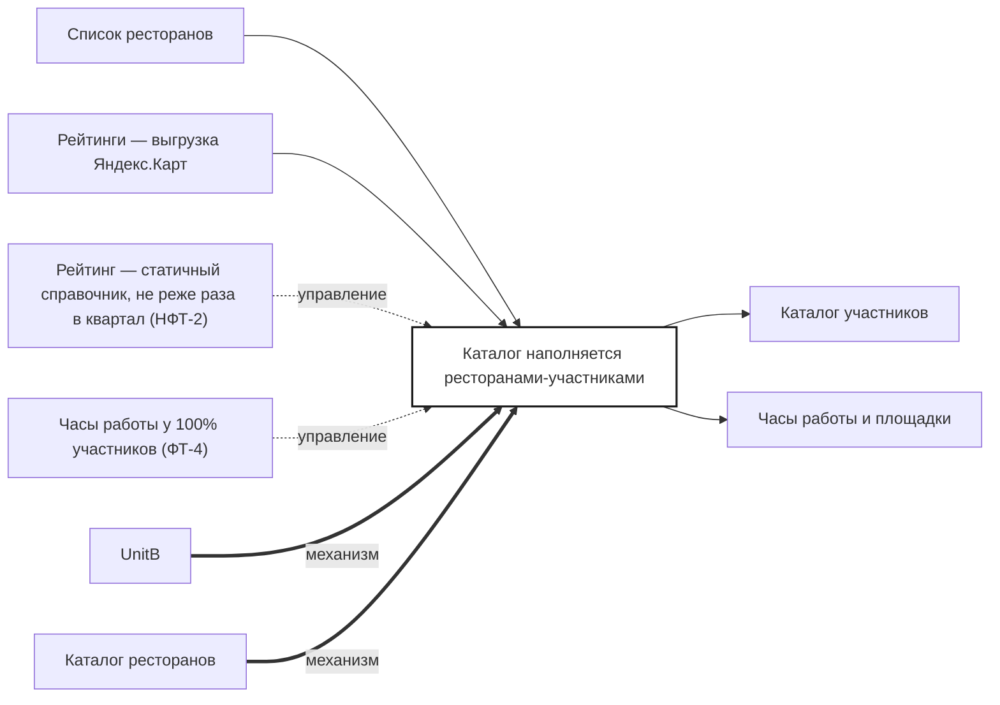

## Description

<!-- SECTION:DESCRIPTION:BEGIN -->
UnitB собирает каталог участников: список от DineClub, рейтинги из справочника не реже раза в квартал, часы работы и площадки рядом.

### Параметры
- **Вход:** Список ресторанов (BP-1.1); Рейтинги — выгрузка Яндекс.Карт
- **Управление:** Рейтинг — статичный справочник, не реже раза в квартал (НФТ-2); Часы работы у 100% участников (ФТ-4)
- **Выход:** Каталог участников (BP-6.1, BP-9.1, BP-11.1); Часы работы и площадки (BP-10.1)
- **Механизм:** UnitB; Каталог ресторанов

### IDEF0

### HowToDemo
1. DineClub передаёт список участников — они появляются в каталоге
2. Выгрузка рейтингов обновляет рейтинги участников
3. У каждого участника есть часы работы и площадки рядом
<!-- SECTION:DESCRIPTION:END -->
