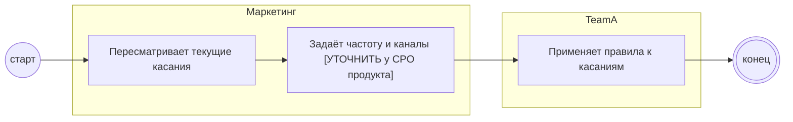

## Description

<!-- SECTION:DESCRIPTION:BEGIN -->
Маркетинг пересматривает частоту и каналы касаний, чтобы напоминания не вели к отпискам и жалобам.

### UserStory
Как маркетинг, я хочу задать частоту и каналы касаний, чтобы напоминания не вели к отпискам и жалобам.

### JobStory
- Когда запускаются касания акции, хочу ограничить их частоту, чтобы гость не отписался.

### Параметры
- **Вход:** Текущие триггерные касания
- **Управление:** Отписки соблюдаются (ФТ-6); Лимит частоты [УТОЧНИТЬ у CPO продукта]
- **Выход:** Частота и каналы касаний (BP-12.2)
- **Механизм:** Маркетинг

### Процесс
- Маркетинг: Пересматривает текущие касания
- Маркетинг: Задаёт частоту и каналы [УТОЧНИТЬ у CPO продукта]
- TeamA: Применяет правила к касаниям

### BPMN

### HowToDemo
1. Правила касаний утверждены: частота и каналы
2. Касания в окне скидки идут по этим правилам, отписки соблюдаются
<!-- SECTION:DESCRIPTION:END -->
