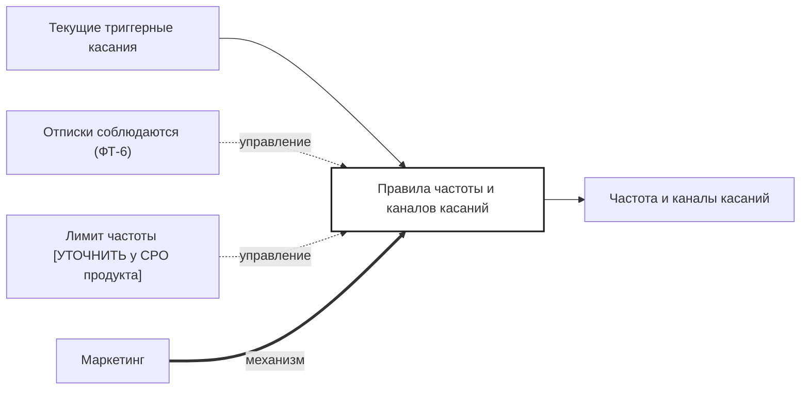

## Description

<!-- SECTION:DESCRIPTION:BEGIN -->
Маркетинг пересматривает частоту и каналы касаний, чтобы напоминания не вели к отпискам и жалобам.

### Параметры
- **Вход:** Текущие триггерные касания
- **Управление:** Отписки соблюдаются (ФТ-6); Лимит частоты [УТОЧНИТЬ у CPO продукта]
- **Выход:** Частота и каналы касаний (BP-12.2)
- **Механизм:** Маркетинг

### IDEF0

### HowToDemo
1. Правила касаний утверждены: частота и каналы
2. Касания в окне скидки идут по этим правилам, отписки соблюдаются
<!-- SECTION:DESCRIPTION:END -->
