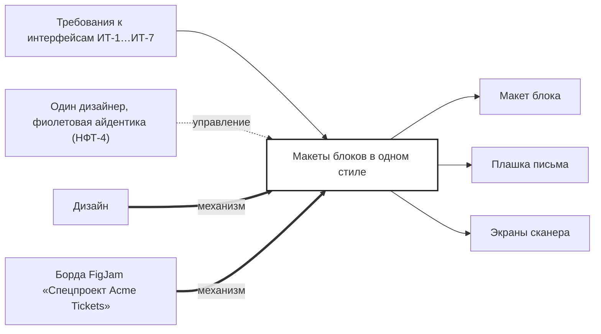

## Description

<!-- SECTION:DESCRIPTION:BEGIN -->
Дизайнер готовит блоки акции в одной фиолетовой айдентике: страница, письмо, экраны сканера.

### Параметры
- **Вход:** Требования к интерфейсам ИТ-1…ИТ-7
- **Управление:** Один дизайнер, фиолетовая айдентика (НФТ-4)
- **Выход:** Макет блока (BP-5.1); Плашка письма (BP-7.1); Экраны сканера (BP-15.1)
- **Механизм:** Дизайн; Борда FigJam «Спецпроект Acme Tickets»

### IDEF0

### HowToDemo
1. Открываю макеты: блок на странице, плашка письма, экраны сканера
2. Все в одной фиолетовой айдентике, автор — один дизайнер
<!-- SECTION:DESCRIPTION:END -->
