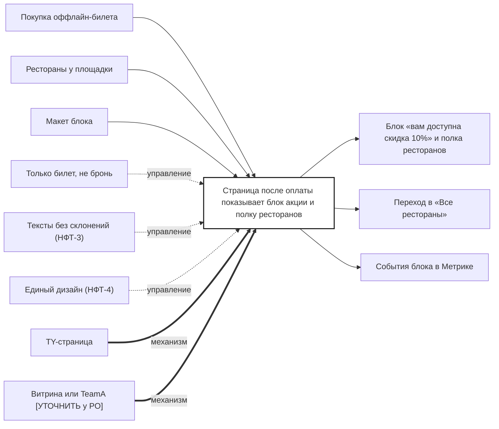

## Description

<!-- SECTION:DESCRIPTION:BEGIN -->
Гость покупает билет на оффлайн-мероприятие — страница после оплаты показывает блок «скидка 10%» и полку ресторанов у площадки билета. События блока уходят в аналитику.

### Параметры
- **Вход:** Покупка оффлайн-билета; Рестораны у площадки (BP-6.1); Макет блока (BP-4.1)
- **Управление:** Только билет, не бронь; Тексты без склонений (НФТ-3); Единый дизайн (НФТ-4)
- **Выход:** Блок «вам доступна скидка 10%» и полка ресторанов; Переход в «Все рестораны» (BP-8.1); События блока в Метрике (BP-19.1)
- **Механизм:** TY-страница; Витрина или TeamA [УТОЧНИТЬ у PO]

### IDEF0

### HowToDemo
1. Покупаю билет на оффлайн-мероприятие
2. На странице после оплаты вижу блок «вам доступна скидка 10%» и полку ресторанов у площадки
3. Нажимаю «Все рестораны» — открывается список участников
4. В Метрике видны события блока
<!-- SECTION:DESCRIPTION:END -->
