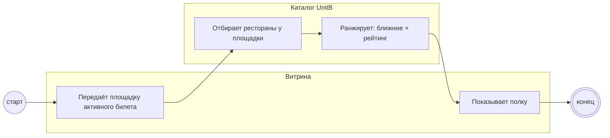

## Description

<!-- SECTION:DESCRIPTION:BEGIN -->
По площадке активного билета UnitB подбирает рестораны для полки: ближние и с высоким рейтингом.

### UserStory
Как гость, я хочу видеть в полке рестораны рядом с моей площадкой, чтобы дойти пешком.

### JobStory
- Когда у меня билет в конкретный театр, хочу видеть рестораны рядом с ним, чтобы не ехать через город.

### Параметры
- **Вход:** Каталог участников (BP-2.1); Площадка активного билета
- **Управление:** Ближние × высокий рейтинг (ФТ-3); Первыми — у площадки активного билета (ФТ-3)
- **Выход:** Рестораны у площадки (BP-5.1)
- **Механизм:** UnitB; Каталог ресторанов

### Процесс
- Витрина: Передаёт площадку активного билета
- Каталог UnitB: Отбирает рестораны у площадки
- Каталог UnitB: Ранжирует: ближние × рейтинг
- Витрина: Показывает полку

### BPMN

### HowToDemo
1. Покупаю билет в театр — полка показывает рестораны у этого театра
2. Ближние и с высоким рейтингом — первыми
<!-- SECTION:DESCRIPTION:END -->
