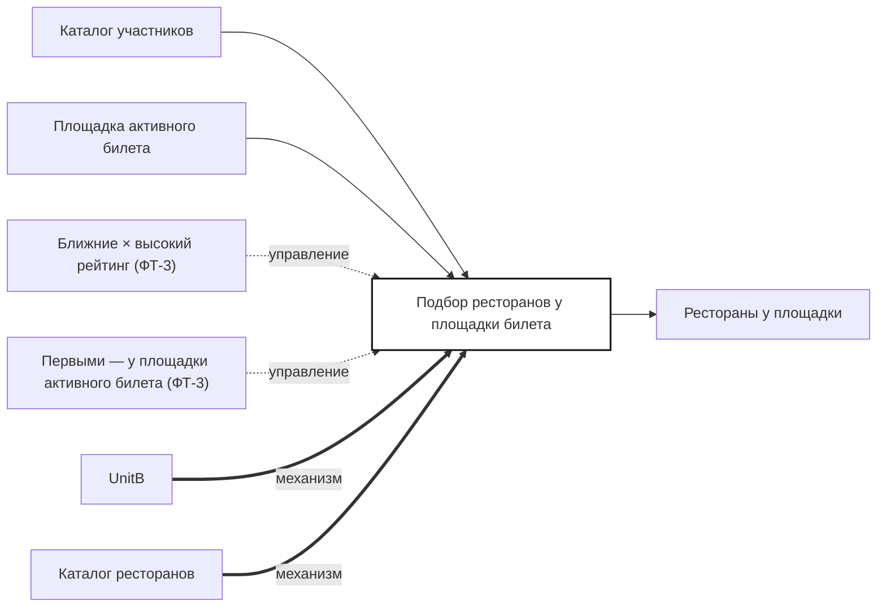

## Description

<!-- SECTION:DESCRIPTION:BEGIN -->
По площадке активного билета UnitB подбирает рестораны для полки: ближние и с высоким рейтингом.

### Параметры
- **Вход:** Каталог участников (BP-2.1); Площадка активного билета
- **Управление:** Ближние × высокий рейтинг (ФТ-3); Первыми — у площадки активного билета (ФТ-3)
- **Выход:** Рестораны у площадки (BP-5.1)
- **Механизм:** UnitB; Каталог ресторанов

### IDEF0

### HowToDemo
1. Покупаю билет в театр — полка показывает рестораны у этого театра
2. Ближние и с высоким рейтингом — первыми
<!-- SECTION:DESCRIPTION:END -->
