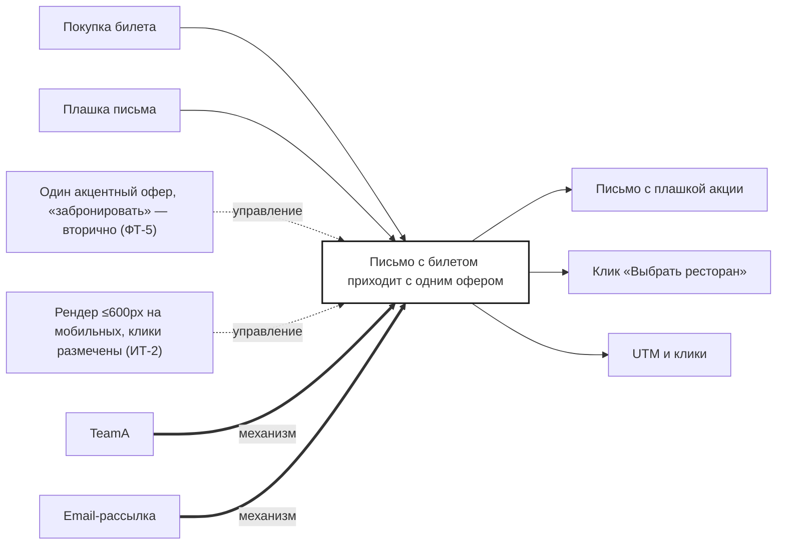

## Description

<!-- SECTION:DESCRIPTION:BEGIN -->
После покупки TeamA отправляет письмо с билетом и одним акцентным офером — скидка 10%. Клик ведёт на страницу акционных ресторанов, UTM — в аналитику.

### Параметры
- **Вход:** Покупка билета; Плашка письма (BP-4.1)
- **Управление:** Один акцентный офер, «забронировать» — вторично (ФТ-5); Рендер ≤600px на мобильных, клики размечены (ИТ-2)
- **Выход:** Письмо с плашкой акции; Клик «Выбрать ресторан» (BP-8.1); UTM и клики (BP-19.1)
- **Механизм:** TeamA; Email-рассылка

### IDEF0

### HowToDemo
1. Покупаю билет — приходит письмо с билетом и одним офером «скидка 10%»
2. «Забронировать в DineClub» — вторичное действие
3. Нажимаю «Выбрать ресторан» — открывается страница акционных ресторанов
4. В аналитике видны UTM и клики по позициям
<!-- SECTION:DESCRIPTION:END -->
