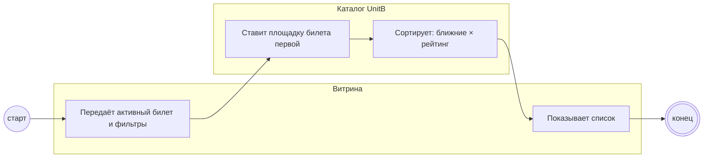

## Description

<!-- SECTION:DESCRIPTION:BEGIN -->
Для списка UnitB ставит первыми рестораны у площадки билета, дальше — по близости и рейтингу, с учётом фильтров гостя.

### UserStory
Как гость, я хочу видеть ближние и хорошие рестораны первыми, чтобы выбрать быстро.

### JobStory
- Когда у меня несколько активных билетов, хочу понимать, по какой площадке список, чтобы не запутаться [УТОЧНИТЬ у PO].
- Когда я включаю фильтры, хочу сохранить порядок, чтобы ближние оставались вверху.

### Параметры
- **Вход:** Каталог участников (BP-2.1); Площадка билета; Выбранные фильтры
- **Управление:** Полный список без радиуса (ФТ-3); Ближние × высокий рейтинг (ФТ-3); Каталог выдерживает 300 ресторанов (НФТ-1)
- **Выход:** Список и данные ресторанов (BP-8.1)
- **Механизм:** UnitB; Каталог ресторанов

### Процесс
- Витрина: Передаёт активный билет и фильтры
- Каталог UnitB: Ставит площадку билета первой
- Каталог UnitB: Сортирует: ближние × рейтинг
- Витрина: Показывает список

### BPMN

### HowToDemo
1. Открываю «Все рестораны» — рестораны у площадки билета первыми
2. Дальше — по близости и рейтингу, без обрезки радиусом
3. Фильтры гостя сужают выдачу
<!-- SECTION:DESCRIPTION:END -->
