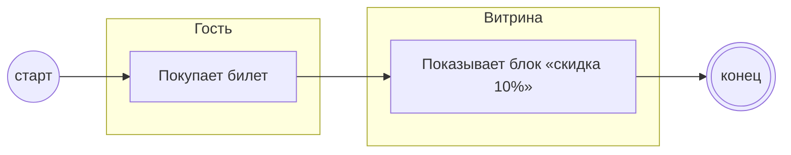

## Description

<!-- SECTION:DESCRIPTION:BEGIN -->
Гость покупает билет — витрина сразу показывает блок «скидка 10%».

### UserStory
Как гость, я хочу сразу после покупки увидеть скидку, чтобы спланировать вечер.

### JobStory
- Когда я оплатил билет, хочу узнать о скидке, чтобы не пропустить её.

### Параметры
- **Вход:** Покупка билета
- **Управление:** Один офер (ИТ-1)
- **Выход:** Блок «скидка 10%»; Гость выбрал ресторан (BP-2.1)
- **Механизм:** Витрина

### Процесс
- Гость: Покупает билет
- Витрина: Показывает блок «скидка 10%»

### BPMN

### HowToDemo
1. Покупаю билет
2. Сразу вижу блок «скидка 10%»
<!-- SECTION:DESCRIPTION:END -->
