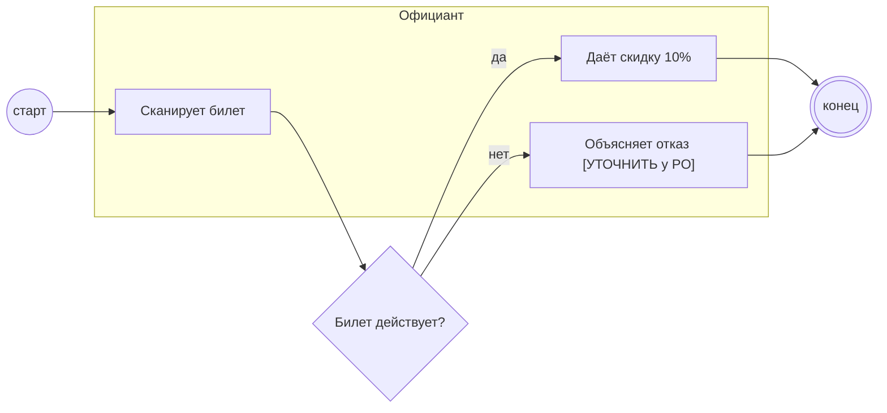

## Description

<!-- SECTION:DESCRIPTION:BEGIN -->
Официант сканирует штрихкод и сразу видит ответ.

### UserStory
Как официант, я хочу сразу видеть ответ проверки, чтобы дать скидку без споров.

### JobStory
- Когда гость показывает билет, хочу быстро понять, давать ли скидку, чтобы не задерживать стол.

### Параметры
- **Вход:** Гость выбрал ресторан (BP-1.1); Ответ проверки (BP-2.2)
- **Управление:** Скидка 10% по билету (ПТ-1)
- **Выход:** Штрихкод на проверку (BP-2.2); Скидка или отказ с причиной [УТОЧНИТЬ у PO]
- **Механизм:** Официант; Сканер

### Процесс
- Официант: Сканирует билет
- ? Билет действует?
  - да → Официант: Даёт скидку 10%
  - нет → Официант: Объясняет отказ [УТОЧНИТЬ у PO]

### BPMN

### HowToDemo
1. Официант сканирует билет
2. Действующий билет — скидка 10%
<!-- SECTION:DESCRIPTION:END -->
