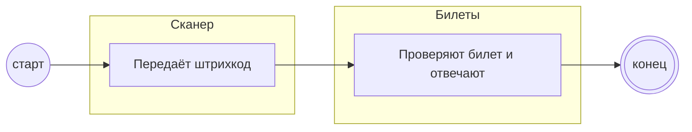

## Description

<!-- SECTION:DESCRIPTION:BEGIN -->
Билеты проверяют штрихкод и отвечают скидкой или отказом.

### UserStory
Как сервис билетов, я хочу проверять штрихкод, чтобы одна покупка давала одну скидку.

### JobStory
- Когда приходит штрихкод, хочу проверить билет, чтобы не выдать лишнюю скидку.

### Параметры
- **Вход:** Штрихкод на проверку (BP-2.1)
- **Управление:** Скидка по билету (ПТ-1)
- **Выход:** Ответ проверки (BP-2.1)
- **Механизм:** Билеты

### Процесс
- Сканер: Передаёт штрихкод
- Билеты: Проверяют билет и отвечают

### BPMN

### HowToDemo
1. Сканирую действующий билет — скидка
2. Сканирую чужой билет — отказ
<!-- SECTION:DESCRIPTION:END -->
